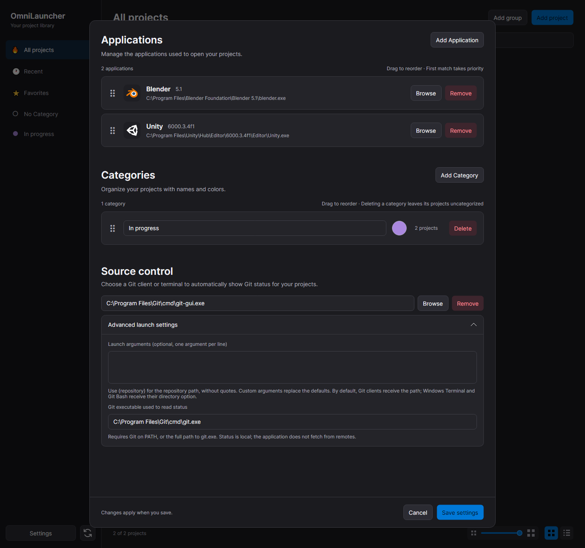
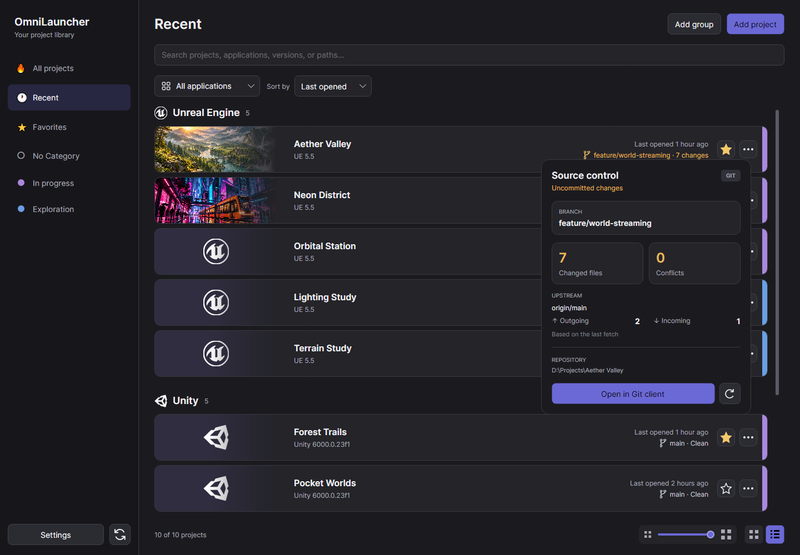

# Source control

[Documentation](README.md) · [User guide](user-guide.md)

## Enable integration

Choose a Git client or terminal in Settings. This is a global setting, not a per-project option. Git must be available on `PATH` or configured in the advanced launch settings; installing a GUI client alone does not necessarily provide the Git executable used to read status.

OmniLauncher searches upward from a project's folder, or a project file's containing folder, for a `.git` directory or file. Linked worktrees and submodules are supported. Projects outside a repository have no badge.



## Read repository status

Click a project's Git badge to see its branch, changed-file and conflict counts, and incoming/outgoing commits relative to the locally cached upstream.

OmniLauncher does not fetch, stage, commit, or change branches. Status refreshes after library loads, when the window activates, and through **Refresh status**. Errors stay visible in the popup. Status processes have a 15-second timeout.



## Open a client or terminal

The configured application opens at the repository root. Git clients receive the repository path as one argument by default.

Windows Terminal, PowerShell, Command Prompt, and Git Bash are detected automatically by executable name. Terminals inherit the repository as their working directory. Windows Terminal also receives `-d`; Git Bash receives `--cd`.

Other applications use the Git-client defaults. Use custom arguments for additional terminal applications or clients with different requirements.

### Custom arguments

Advanced launch arguments replace the defaults. Enter one argument per line. `{repository}` expands to the repository path without adding quotes or invoking a command shell.

For a client that expects `--path`, enter:

```text
--path
{repository}
```

Removing the configured application disables the integration.

## Stored settings

Configuration is saved in the library's `sourceControl` object.

See [Library storage and recovery](library-storage.md) for the library location and backup behavior.
