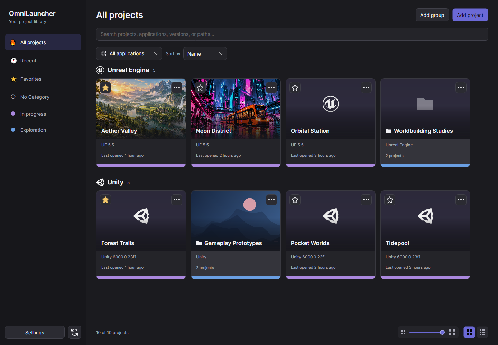
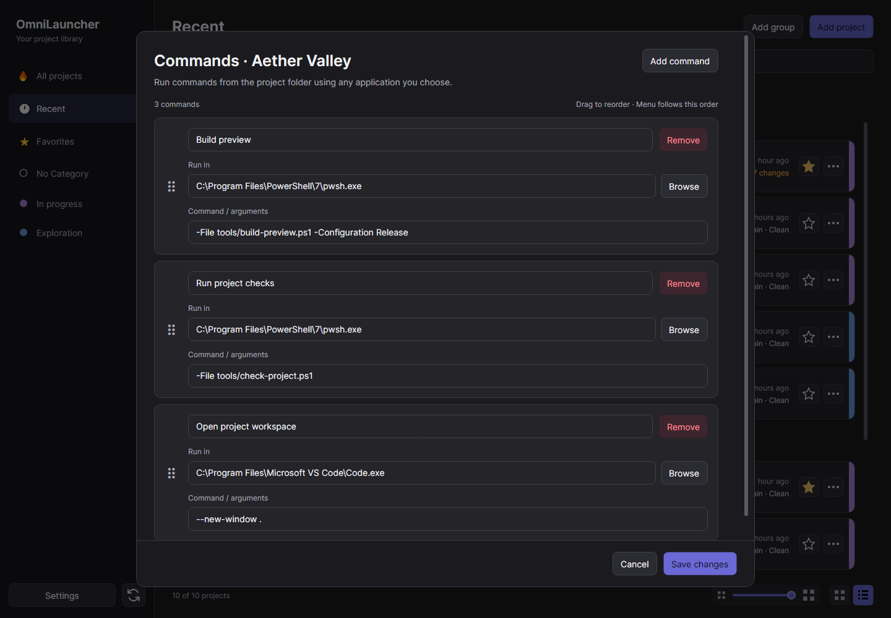
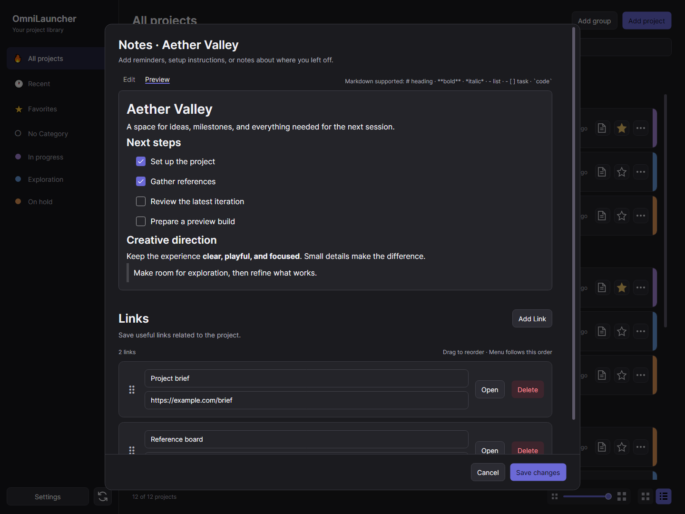

# OmniLauncher

**One library for your creative projects.**

OmniLauncher is a desktop hub for sorting and launching projects across game engines, design tools, and code editors. Organize your work, keep notes beside each project, and open it with the right application.

Built with **C#**, **.NET 10**, and **Avalonia 12**. Windows is the primary target.



## Features

- **A shared project library** — browse by application, category, recent activity, or favorites.
- **Flexible organization** — search, sort, create groups, categories, and switch between adjustable tile and list layouts.
- **Application selection** — register installed applications, match project versions, and choose per-project overrides.
- **Project notes and links** — write Markdown, preview task lists, and keep useful resources close at hand.
- **Project covers** — use custom artwork or embedded file previews when available.
- **Desktop shortcuts** — launch from the system tray or assign global shortcuts, including a shared shortcut for several projects.
- **Custom commands** — keep project-specific commands alongside the project for quick execution.
- **Git integration** — inspect local repository status and open your preferred Git client or terminal.

## Supported applications

| Application | Project selection | Automatic application matching |
| --- | --- | --- |
| Unreal Engine | Folder containing a `.uproject` file | Engine major/minor version |
| Unity | Folder containing `ProjectSettings/ProjectVersion.txt` | Exact editor version |
| Blender | `.blend` file | Major/minor version |
| Affinity | `.af` document | Registered executable; no version requirement |
| Visual Studio Code | Folder or `.code-workspace` file | Registered executable; no version requirement |

Other applications will be added in time.

Applications must be installed separately.

## Build and run

Install the .NET 10 SDK, then run these commands from the repository root:

```sh
dotnet restore OmniLauncher.csproj
dotnet build OmniLauncher.csproj -c Release --no-restore
dotnet run --project OmniLauncher.csproj -c Release --no-build
```

The app uses Avalonia, but its executable selection, tray behavior, and global shortcuts are designed primarily for Windows. macOS and Linux compatibility has not been validated.

### First launch

1. Open **Settings** and register the compatible applications you use.
2. Choose **Add project**, select its application, and browse to the project folder or file.
3. Add a category or cover if desired, then save.
4. Open a project from its card. Use its actions menu to edit it, manage notes and links, or access other project tools.

Closing the window on Windows hides the launcher in the system tray. Choose **Exit OmniLauncher** from the tray menu to quit.

### Publish for Windows x64

Create a self-contained executable with no separate .NET runtime installation required:

```sh
dotnet publish OmniLauncher.csproj -c Release -r win-x64 --self-contained true -p:PublishSingleFile=true -p:EnableCompressionInSingleFile=true -p:IncludeNativeLibrariesForSelfExtract=true -p:DebugType=None -o publish
```

Build and publish output is excluded from version control.

## Screenshots

Captured from the application using an isolated library of fictional projects.

### Git integration in list view


### Custom commands



### Notes and links



### Settings


## Data and shortcuts

The library is stored at `%LOCALAPPDATA%\OmniLauncher\projects.json`. Saves keep the previous version in a `.bak` file. 

Removing a project from the library does not delete its files/folders.

| Shortcut | Action |
| --- | --- |
| `Ctrl+F` | Focus search |
| `F5` | Refresh the library |
| `Escape` | Dismiss the active dialog when no operation is in progress |

## Source layout

```text
Assets/                    Application icons and artwork
Controls/                  Reusable controls and project cards
Converters/                Avalonia binding converters
Models/                    Project, category, group, and settings types
Services/
  Desktop/                 System tray and global shortcut integration
  ProjectLoaders/          Application-specific project readers
  ...                      Persistence, launching, and Git services
Styles/                    Shared Avalonia styles
ViewModels/                MVVM state and commands
Views/                     Windows and dialogs
Docs/                      Technical documentation and screenshots
App.axaml                  Application resources and startup lifecycle
Program.cs                 Desktop entry point
OmniLauncher.csproj        Application project and dependencies
```

## Documentation

Start with the [documentation index](Docs/README.md), or jump to a guide:

- [User guide](Docs/user-guide.md) — settings, library navigation, categories, and groups.
- [Application integrations](Docs/integrations.md) — supported formats, matching, and previews.
- [Source control](Docs/source-control.md) — Git status and client or terminal setup.
- [Library storage and recovery](Docs/library-storage.md) — data format and backups.
- [Adding application support](Docs/application-support.md) — developer extension guide.

## AI disclosure

AI tools are used to assist with the development and documentation of OmniLauncher. Portions of the code and documentation are AI-generated or AI-assisted.

## License

OmniLauncher is licensed under the [MIT License](LICENSE).

Copyright (c) 2026 Alessandro Lusetti (alleluso).
